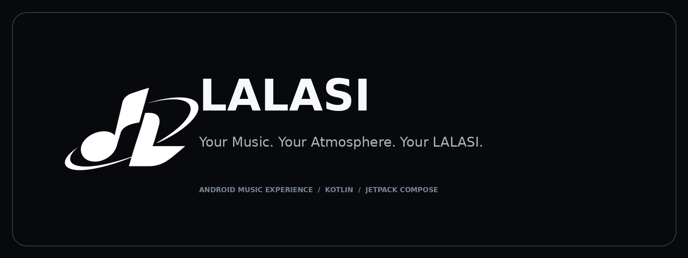
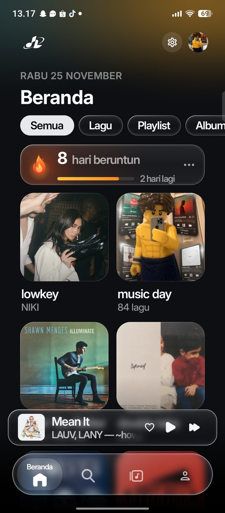
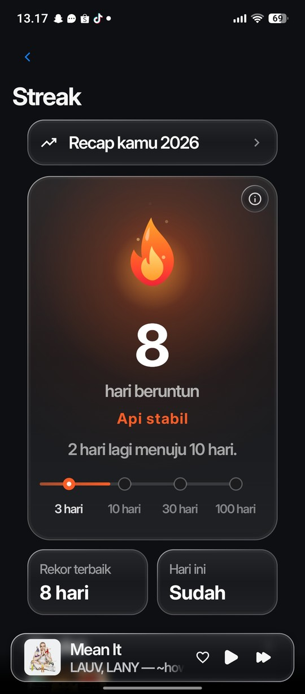
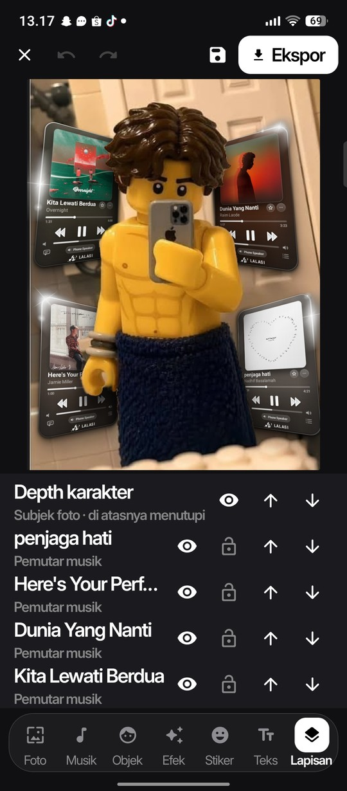

<div align="center">



# LALASI

**Your Music. Your Atmosphere. Your LALASI.**

Pemutar musik Android dengan antarmuka Liquid Glass, Dynamic Island yang mengikuti warna sampul, dan animasi yang dibuat untuk terasa mulus.

[](#-download)
[](#)
[](#)
[](#)

[**Download**](#-download) · [**Tampilan**](#%EF%B8%8F-tampilan) · [**Fitur**](#-fitur) · [**Yang baru di 2.2.9**](#-yang-baru-di-229) · [**Build**](#-build-dari-source)

</div>

---

## 🖼️ Tampilan

<div align="center">
<table>
  <tr>
    <td align="center"></td>
    <td align="center"></td>
    <td align="center"></td>
  </tr>
  <tr>
    <td align="center"><b>Beranda</b><br><sub>Streak, sampul, mini player, navbar liquid glass</sub></td>
    <td align="center"><b>Streak</b><br><sub>Api harian dan target 3 / 10 / 30 / 100 hari</sub></td>
    <td align="center"><b>Poster Studio</b><br><sub>Lapisan, depth karakter, pemutar musik</sub></td>
  </tr>
</table>
</div>

## ✨ Yang baru di 2.2.9

| | |
|---|---|
| 🏝️ **Dynamic Island kaca cair** | Latar memakai sampul lagu yang sedang diputar, tertarik melar dan berkabut halus. Sampul kini diminta dalam 544 px dengan filter High, jadi tidak lagi burik atau kotak-kotak. |
| 🫘 **Aksen kiri-kanan organik** | Aksen berbentuk kacang gemuk menempel ke dinding panel, dengan kontur terang, isi susu translusen, glow lembut, dan pantulan tipis. Warnanya diambil dari sampul. |
| 🎨 **Warna adaptif** | Warna dominan dan warna kedua dari sampul dipakai untuk aksen, glow, dan rim. Pergantian lagu dicampur halus selama 0,9 detik, tanpa kedip. |
| 🌫️ **Anti-banding** | Dither halus di shader menghilangkan garis-garis pada gradasi blur. Android di bawah 13 tetap mendapat efek melar berbasis transform GPU. |

Riwayat lengkap ada di [`CHANGELOG.md`](CHANGELOG.md) dan berkas `LALASI-2.x.x-*.md` di root repo.

## 📥 Download

Ambil APK terbaru dari **[Releases](../../releases)** atau dari artifact build di tab **Actions**.

- Nama file: `LALASI-v2.2.9-arm64-release.apk`
- Application ID: `com.danrey.lalasi` · versi `2.2.9` (kode `229`)
- Minimal Android 7.0 (API 24). Efek melar shader penuh butuh Android 13+.

### Memperbarui aplikasi

Pasang APK baru langsung di atas yang lama, **tidak perlu uninstall**, selama:

1. Application ID sama (`com.danrey.lalasi`),
2. APK ditandatangani dengan kunci yang sama (`app/persistent-debug.keystore` di repo ini),
3. `versionCode` lebih tinggi dari yang terpasang.

> **Catatan sekali saja:** kalau APK yang terpasang dulu dibuild dengan kunci lain, Android menolak update dan kamu perlu uninstall **satu kali**. Setelah itu semua versi berikutnya bisa langsung di-update. Cadangkan data dulu bila perlu.

## 🎧 Fitur

- **Pemutaran musik** dengan Media3, pemutaran latar belakang, dan integrasi media session.
- **Pencarian dan jelajah** lewat provider yang terpasang.
- **Library dan playlist**, mini player, dan player layar penuh.
- **Lirik** berjalan (sinkron bila tersedia) dari beberapa provider.
- **Liquid Glass UI**: permukaan kaca translusen, tepi spekular, dan tampilan berbasis sampul album.
- **Dynamic Island**: kontrol musik berkaca cair dengan latar sampul dan aksen yang mengikuti warna album.
- **Navigasi elastis**: capsule bar dengan gelembung gesture dan geser antar halaman.
- **Streak** harian dengan tingkat api dan target berjenjang, plus **Recap** tahunan.
- **Poster Studio**: susun poster dari foto, objek, stiker, teks, dan pemutar musik dalam lapisan, dengan efek depth pada subjek foto.
- **Widget layar utama** (10 varian): Compact, Square, Wide, Expanded, Large Square, Live Lyrics, Compact Lyrics, Wide Lyrics, Minimal, dan Artwork Player.
- **Kustomisasi** tema dan tampilan.

Ketersediaan layanan bergantung pada konfigurasi provider, jaringan, wilayah, dan perubahan layanan pihak ketiga.

## 🛠️ Teknologi

Kotlin · Jetpack Compose · AGSL · AndroidX Media3 · Room · Hilt · DataStore · Ktor · Coil
`compileSdk 36` · `minSdk 24` · `targetSdk 36` · Gradle Wrapper `9.3.1`

## 🔨 Build dari source

```bash
git clone <URL-REPOSITORY-LALASI>
cd LALASI
chmod +x gradlew
./gradlew :app:assembleUniversalGmsDebug
```

APK ada di `app/build/outputs/apk/universalGms/debug/`. Build memakai JDK 21 dan Android SDK 36.
GitHub Actions (`.github/workflows/android-build.yml`) membuat APK dan mengunggahnya sebagai artifact `LALASI-v2.2.9-arm64-release.apk`.

### Tentang kunci tanda tangan

`app/persistent-debug.keystore` sengaja ikut di repo supaya setiap build (lokal maupun CI) memakai tanda tangan yang sama dan bisa saling meng-update. Kunci ini **hanya untuk build debug/uji**. Untuk rilis publik, siapkan keystore rilis sendiri dan simpan di luar repo (lihat `signingConfigs.release` di `app/build.gradle.kts`, dibaca dari `KEY_ALIAS`, `KEY_PASSWORD`, `STORE_PASSWORD`). Jangan pernah meng-commit kunci rilis atau API key pribadi.

## 🗂️ Struktur proyek

```text
LALASI/
├── app/          # aplikasi Android: UI, playback, database, resource
├── providers/    # provider musik, lirik, metadata, dan media
├── modules/      # modul API dan layanan bersama
├── assets/       # logo, banner, social preview, screenshot
├── docs/         # catatan publikasi
└── fastlane/     # metadata dan changelog
```

## 👤 Developer

**danrey** — dirancang dan dikembangkan dengan fokus pada pengalaman musik modern, antarmuka elegan, dan interaksi yang mulus.

- Instagram: [@devreyw_](https://www.instagram.com/devreyw_/)
- TikTok: [@danhanzyr](https://www.tiktok.com/@danhanzyr)

## 🙏 Kredit dan lisensi

LALASI memakai modul provider pihak ketiga dan dependensi open source; penulis, lisensi, dan atribusinya tetap berlaku. Lihat [`LICENSE`](LICENSE) (tidak diubah) serta direktori provider/modul terkait. Periksa semua ketentuan sebelum mendistribusikan ulang repo atau biner hasil modifikasi.

## ⚠️ Disclaimer

LALASI dapat berkomunikasi dengan layanan musik, lirik, metadata, dan media pihak ketiga lewat provider yang dikonfigurasi. Layanan itu dioperasikan secara independen dan dapat berubah. LALASI tidak mengklaim kepemilikan atas katalog atau media pihak ketiga. Pengguna bertanggung jawab mematuhi ketentuan layanan dan hukum setempat.

---

<div align="center">

**LALASI** · A listening experience shaped around your atmosphere.

</div>
