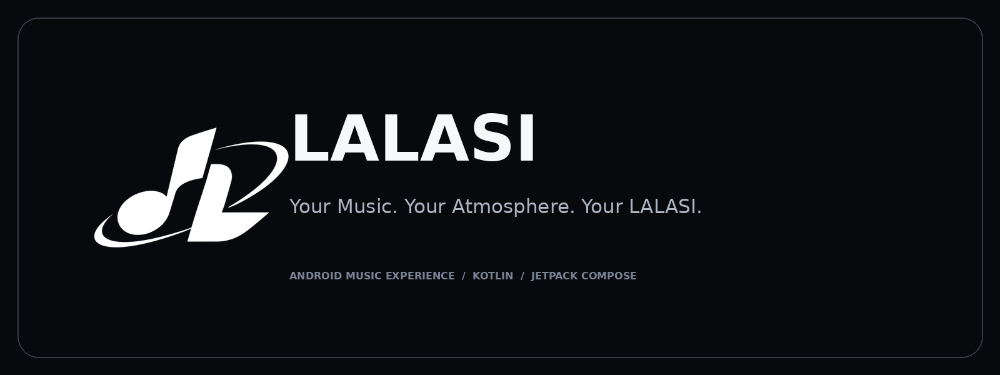

<div align="center">



# LALASI

**Your Music. Your Atmosphere. Your LALASI.**

A modern Android music experience built around expressive listening, a refined Liquid Glass interface, and fluid navigation.

[](#)
[](#)
[](#)
[](#)

</div>

---

## Overview

LALASI is an Android music application project focused on a considered listening experience. Its interface combines a dark visual foundation, translucent glass surfaces, album-oriented presentation, and gesture-aware navigation.

The repository contains the Android application and its supporting provider and module projects.

- Application ID: `com.danrey.lalasi`
- Current source version: `1.0.1` (version code `101`)

Service availability can depend on provider configuration, network access, region, and third-party service changes.

## Features

The following capabilities are represented in the current source tree. Actual availability may vary with configuration and connected providers.

- Music playback powered by the existing Media3 playback stack.
- Background playback and media-session integration.
- Music search and provider-backed browsing.
- Library and playlist-oriented music organization.
- Mini player and expanded player surfaces.
- Lyrics presentation and lyric-provider integrations.
- Ambient visual experience in the player.
- Theme and appearance customization.
- Translucent Liquid Glass-inspired surfaces.
- Animated bottom navigation with a spring-driven selection indicator and horizontal gesture support.

## Preview

Application screenshots are intentionally not fabricated. Add screenshots captured from a real running build to [`assets/screenshots/`](assets/screenshots/README.md).

Suggested captures:

| Screen | Suggested file |
| --- | --- |
| Home | `home.png` |
| Player | `player.png` |
| Navigation | `navigation.png` |
| Lyrics | `lyrics.png` |
| Ambient | `ambient.png` |
| Library | `library.png` |
| Settings | `settings.png` |

## Technology

Technology and libraries visible in the project configuration:

- **Kotlin** — application language.
- **Jetpack Compose** — declarative UI.
- **Android SDK** — `compileSdk 36`, `minSdk 24`, `targetSdk 36`.
- **Gradle Wrapper** — project-configured Gradle distribution.
- **AndroidX Media3** — playback, media session, and related media components.
- **Room** — local database layer.
- **Hilt** — dependency injection.
- **DataStore** — preferences and persisted settings.
- **Ktor** — networking infrastructure.
- **Coil** — image loading.

## Getting started

### Requirements

- Android Studio with a compatible Android Gradle Plugin and Kotlin toolchain.
- JDK version supported by the configured Gradle and Android Gradle Plugin.
- Android SDK platform and build tools required by the project (`compileSdk 36`).
- Network access for the first Gradle dependency resolution.

### Clone

```bash
git clone <YOUR-LALASI-REPOSITORY-URL>
cd LALASI-main
```

Replace the repository URL with the actual GitHub clone URL after publishing the repository.

### Open and run

1. Open the project root (`LALASI-main`) in Android Studio.
2. Allow Android Studio to sync the Gradle project.
3. Install any Android SDK components requested by the IDE.
4. Select the `app` run configuration and a compatible Android device or emulator.
5. Run the application from Android Studio.

The Gradle wrapper currently requests Gradle `9.3.1`. Use the wrapper configuration supplied with this repository rather than changing the Gradle distribution without checking Android Gradle Plugin compatibility.

Some provider integrations may require configuration, credentials, regional availability, or network access. Do not commit private API keys, signing keys, or local configuration files.

## Project structure

```text
LALASI-main/
├── app/                 # Android application, UI, playback, database and resources
├── providers/           # Music, lyrics, metadata and media provider integrations
├── modules/             # Shared API and service modules
├── gradle/              # Gradle wrapper configuration
├── assets/
│   ├── logo/            # LALASI logo and repository icon assets
│   ├── banner/          # Repository banner
│   ├── social/          # GitHub social preview artwork
│   └── screenshots/     # Real application screenshots (add after capture)
├── docs/                # Repository publishing notes
├── README.md
└── LICENSE
```

## Developer

### Meet the Developer

**danrey**  
LALASI developer credit is present in the application source.

Designed and developed with a focus on modern music experiences, elegant interfaces, and seamless interaction.

- Instagram: [@devreyw_](https://www.instagram.com/devreyw_/)
- TikTok: [@danhanzyr](https://www.tiktok.com/@danhanzyr)
- GitHub: add the verified developer profile URL before publishing.

## Credits

LALASI includes existing third-party provider modules and open-source dependencies. Their respective authors, licenses, and attribution notices remain part of the source project. See [`LICENSE`](LICENSE) and the relevant provider/module directories for applicable notices.

## License

The original [`LICENSE`](LICENSE) file is retained unchanged. Review its terms and all third-party notices before redistributing this repository or publishing modified binaries.

## Disclaimer

LALASI may communicate with third-party music, lyrics, metadata, and media services through its configured providers. Those services are independently operated and may change their availability, content, API behavior, or terms. LALASI does not claim ownership of third-party catalogs or media. Users are responsible for complying with applicable service terms and local law.

---

<div align="center">

**LALASI** · A listening experience shaped around your atmosphere.

</div>
